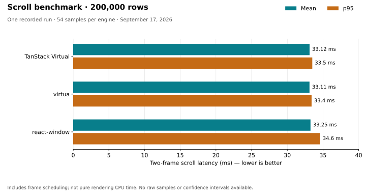

# Virtuality benchmark

A fixed-height table benchmark comparing **TanStack Virtual**, **virtua**, and **react-window** using **Preact's React compatibility layer**. Each implementation uses the same 200,000-record dataset, six columns, 42px rows, a 420px viewport, and 720px-wide row content.

## Run locally

```bash
bun install
bun run dev
```

For runtime measurements, use the production build:

```bash
bun run build
bun run preview
```

Open the preview URL, normally `http://localhost:4173`. Scroll a panel manually, toggle **Sync scroll**, or select **Run scroll benchmark**. Keep the tab visible, avoid input during a run, and use a wide window with all three panels visible. Developer tools, background work, and off-screen panels can affect the results.

## Benchmark report — September 17, 2026

### Scroll performance

The following results come from one completed production-preview run in the Codex in-app browser on Windows, recorded during the optimization task. Each engine was measured 54 times after warm-up. The CPU model, browser version, viewport dimensions, and display refresh rate were not recorded, so this is an illustrative local result, not a reproducible hardware comparison or a universal ranking.

| Implementation | Mean two-frame latency | p95 two-frame latency | Samples |
| --- | ---: | ---: | ---: |
| TanStack Virtual | 33.12 ms | 33.5 ms | 54 |
| virtua `experimental_VGrid` | 33.11 ms | 33.4 ms | 54 |
| react-window `List` | 33.25 ms | 34.6 ms | 54 |



**Interpretation:** mean values span only 0.14ms. All three are close to the two-frame budget of a 60Hz display (about 33.3ms), although the actual refresh rate was not recorded. This measurement is dominated by frame scheduling and does not resolve small differences in rendering CPU cost. react-window had a higher observed p95 in this run; one run without retained raw samples is insufficient to establish a consistent performance difference. There is no defensible overall speed winner from these results.

The metric starts immediately before assigning `scrollTop` and stops at the second subsequent `requestAnimationFrame` boundary. It includes browser scheduling and gives scroll handlers and list updates time to run, but does **not** measure pure render time, prove paint completion, measure sustained-scroll FPS, or establish responsiveness under every workload. The workload consists of large jumps, not continuous wheel scrolling.

Results were transcribed from the UI: means have two decimal places and p95 values one decimal place. Raw per-jump samples were not retained. The recorded data and provenance are in [docs/scroll-results.json](docs/scroll-results.json); the chart uses exactly those values, with a zero baseline and no inferred error bars.

### Minified and gzip size

These are **actual emitted JavaScript chunk sizes**, not npm package download sizes or sums of independently compressed modules. The analysis build isolates each library and shared dependencies into separate chunks while retaining the imports used by this application and tree-shaking unused exports. TanStack includes both its React adapter and virtual core; virtua includes the selected experimental grid; react-window includes `List`.

<!-- bundle-sizes:start -->
| Library / shared dependency | Minified bytes | Gzip bytes (level 9) |
| --- | ---: | ---: |
| @tanstack/react-virtual + @tanstack/virtual-core | 25,120 | 7,419 |
| virtua (experimental_VGrid) | 7,868 | 3,984 |
| react-window (List) | 8,251 | 3,201 |
| Shared Preact runtime | 17,781 | 7,254 |
| Shared signals | 7,754 | 2,951 |
<!-- bundle-sizes:end -->

Versions measured: `@tanstack/react-virtual` 3.14.13 + `@tanstack/virtual-core` 3.17.11, `virtua` 0.51.3, `react-window` 2.3.1, `preact` 11.0.0-rc.2, and `@preact/signals` 2.11.2. Exact versions and byte counts are retained in [docs/bundle-sizes.json](docs/bundle-sizes.json).

**Interpretation:** virtua has the smallest minified library chunk, while react-window has the smallest gzip chunk. TanStack is largest in both measures for the APIs imported here. The size ordering changes after compression, so the smallest minified file is not necessarily the smallest transfer. Shared Preact/compat and signals are listed separately and should not be charged to each library independently.

Sizes include chunk import/export glue and exclude source maps, CSS, HTML, and application code. Gzip uses level 9, matching visualizer; Vite's console can show slightly different gzip numbers because its compression settings differ. Splitting changes minification and compression boundaries, so these values are not exact marginal contributions to the normal single-bundle build, nor total sizes of standalone applications. They quantify the library chunks in this analytical build.

## Visualizer: rendered, gzip, and Brotli

```bash
bun run analyze
bun run preview
```

Open [the chunk size report](http://localhost:4173/bundle-stats.html). Select **Gzip** in its size controls to compare compressed sizes, or hover a chunk to inspect its rendered, gzip, and Brotli values. The libraries have named chunks; shared Preact and signals have their own chunks. The report's rendered size is the minified emitted chunk's UTF-8 byte size.

A separate [module attribution report](http://localhost:4173/bundle-modules.html) shows source-map attribution within those chunks. It is uncompressed only: the installed `rollup-plugin-visualizer` 7.1.1 explicitly disables gzip/Brotli calculation in source-map mode. The main report instead measures complete emitted chunks with source-map attribution disabled, so compression values are real and non-zero. This corrects the earlier configuration that requested gzip alongside `sourcemap: true` but produced no gzip data.

`bun run analyze` also checks visualizer's values against the files using Node's gzip level 9, saves `docs/bundle-sizes.json`, and refreshes the size table above. Only analytical builds split library chunks; use `bun run build` for runtime benchmarking. Either build replaces `dist`, so a normal build removes the analytical HTML reports.

## Measurement isolation

- The dataset is created once and shared across all implementations.
- Memoized table adapters receive stable registration and scroll callbacks. react-window receives a stable row component and row props; TanStack's size/key callbacks and virtua's row renderer are stable too.
- Row counters use `@preact/signals` to update only their own components. Their 250ms sampling timer and DOM scans are disabled during benchmark runs. Scroll handlers do not count DOM rows.
- A dedicated benchmark flag disables scroll synchronization throughout warm-up, measurements, and reset. A pending manual-sync callback cannot release that flag.
- Each engine is warmed up first. Three rounds rotate the order: TanStack → virtua → react-window; virtua → react-window → TanStack; react-window → TanStack → virtua.
- Each round has 18 non-zero jumps per engine. All adapters use native `scrollTop`; target positions use the smallest actual scroll range across the three panels. There are 200ms settling periods between passes for pending scroll-end work.
- Results are published once after all 162 timed jumps. p95 uses the nearest-rank definition.
- Keyboard/pointer/touch/wheel input, window resizing, or a visibility change invalidates a run. Partial results are discarded. A hidden tab may finish cancellation only after rAF resumes.
- The three tables remain mounted, but only the measured one scrolls. Overscan policies differ: eight rows in TanStack/react-window versus a 336px buffer in virtua do not guarantee the same DOM row count.

This benchmark compares the chosen adapters under Preact compatibility, including an experimental virtua API. It does not establish how the libraries compare under native React, variable-height rows, continuous scrolling, different overscan policies, or different devices.

## Regenerate the chart

The checked-in chart is a static SVG generated from the recorded results:

```bash
python -m pip install matplotlib
python scripts/plot-scroll.py
```

Running this command redraws the recorded run; it does not execute a new browser benchmark. To publish a new run, first replace the observed values and provenance in `docs/scroll-results.json`, then update the performance table and regenerate the chart.
